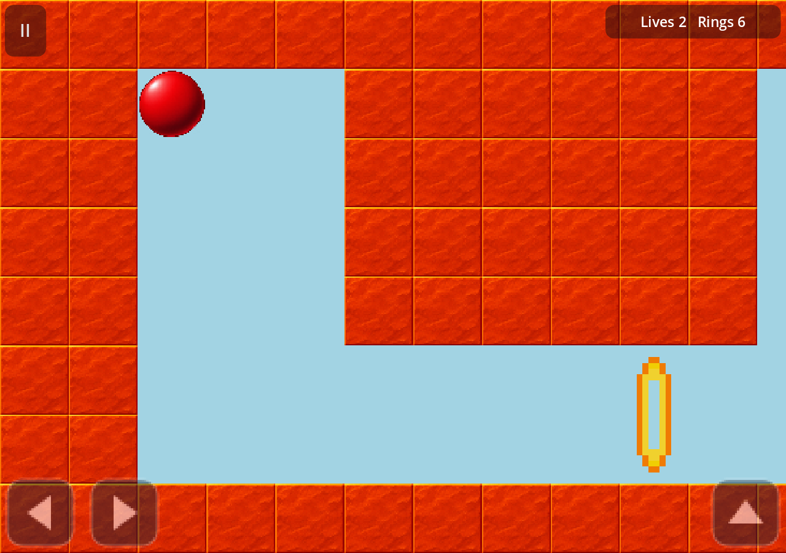

# Bounce Duo

Bounce Duo is an iPhone and iPad adaptation of [Mycron’s Bounce (2001) Remake](https://mycron.itch.io/bounce-remake). It includes the remake’s 11-level campaign, artwork, and recorded sound effects, with larger touch controls and an adaptive layout for compact and open screens.

## Download

[Download the v0.1.8 prerelease](https://github.com/wireproof/BounceDuo/releases/tag/v0.1.8). The IPA is unsigned and needs signing or a compatible sideloading environment. Minimum deployment target: iOS 15. App name: **Bounce**. Bundle identifier: `com.wireproof.bounce`.

## Features

- Fully offline gameplay with all game assets bundled.
- Compact rounded left/right controls and a separate jump button, with a compact pause control.
- Adaptive portrait and landscape layouts with aspect-preserving graphics.
- Pause, Resume, Menu, and automatic pause when the app loses focus.
- Controller D-pad and A-button input mappings. Movement buttons automatically hide on controller connection/input or keyboard use, and return on touchscreen input. Hidden controls release their reserved layout space.
- Landscape Fill mode uses the entire game window with translucent controls and small lives/rings counters and a power-up timer; the score and other controls appear when paused; Fit restores the original framing. The horizontal camera span adapts to the display, retaining the 96-unit vertical playfield. Toolbar and touch targets respect safe areas.
- Experimental Remaster graphics replace the ball and terrain at 4x internal rendering resolution. Pause to switch between Remaster and crisp Original. Smooth filtering remains disabled.
- Level-unlock and high-score persistence. Continue restarts the unlocked level; it does not restore an exact mid-level snapshot.

The port preserves the remake’s physics and levels. This is the first device preview of replacement ball and terrain artwork. Rings, hazards, water, power-ups and animation polish remain unfinished. Original physics and collision resources are retained.

## Status and verification

**v0.1.8 / build 9 is a development prerelease.** The approved remastered icon is included. The iOS release build and signature checks passed; device delivery verification is recorded separately. Physical-device gameplay and visual checks have not been performed for this version.

Earlier builds received successful user gameplay feedback. Desktop checks covered movement, pause/resume, all 11 level scenes loading, and layout previews. Those checks are not a full campaign playthrough. The headless test harness has reported cleanup-time resource leaks. The published screenshots are development captures, not proof of the current physical-device appearance.



## Build

Requires macOS, Xcode, Python 3, **Godot 4.3 stable**, and its matching iOS export templates. Install the templates through Godot or place the matching `ios.zip` at `tools/ios-4.3/ios.zip`. Godot engine binaries and SDKs are external build tools, not project assets.

```sh
GODOT_BIN=/Applications/Godot.app/Contents/MacOS/Godot ./build.sh
```

The script exports the Xcode project, applies the UIKit scene-lifecycle adapter, builds without signing, and creates the IPA in `dist/`. For signing and device installation, use your own Apple development configuration. The export preset’s team identifier is a placeholder for unsigned project export.

```sh
"$GODOT_BIN" --headless --path game --script duo_checks.gd
"$GODOT_BIN" --path game --rendering-method gl_compatibility --script duo_smoke.gd
```

The second command generates temporary desktop layout previews. It is not an iOS runtime test.

## Source layout

- `game/`: complete Godot project, all level scenes, scripts, sprite/image assets, button SVGs, and sound files.
- `game/shaders/`: optional pixel-art upscaler.
- `native/`: UIKit scene adapter used with the Godot 4.3 iOS template.
- `tools/`: export patching and IPA packaging scripts.
- `docs/assets-manifest.json`: hashes of the bundled source asset files.

The project was recovered from the published Android remake and adapted for iOS. Mycron created the remake; the original Bounce game and artwork are credited to Nokia and their respective creators. The remake credits Adrot/The Spriters Resource for sprite assets and uses effects recorded from the game. Godot is MIT-licensed. This project is not affiliated with Nokia or Mycron.
