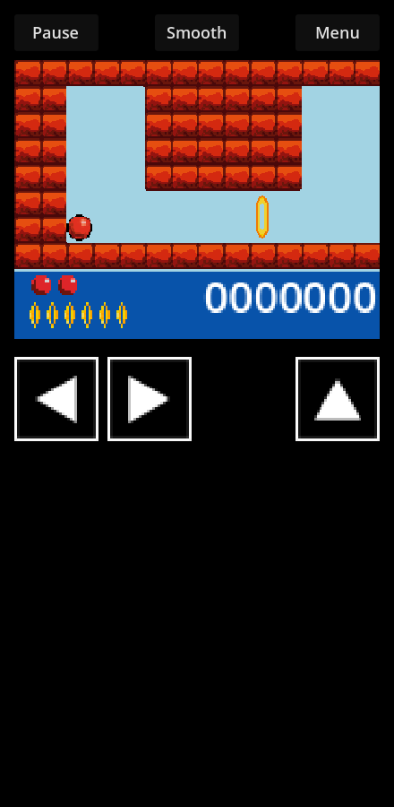
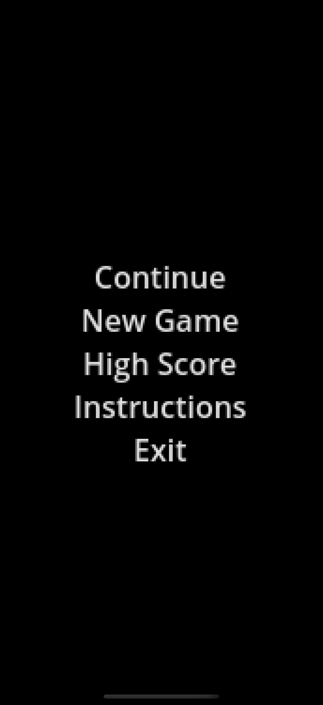

# Bounce Duo

An unofficial iOS test port of [Mycron’s Bounce (2001) Remake](https://mycron.itch.io/bounce-remake), adapted for the iPhone and Duo. It retains the remake’s levels, artwork and sound and adds touch controls and adaptive layouts.

| Compact layout | iOS menu |
| --- | --- |
|  |  |

Screenshots are development captures and may not represent the latest build.

## Install

The [0.1.3 release](../../releases/tag/v0.1.3) contains an unsigned IPA. It must be signed or imported into a compatible sideloading environment. Transfer and readback were verified; physical Duo gameplay and appearance remain unconfirmed for this build.

## Source

The recovered Godot project is in `game/`. `build.sh` and `tools/` contain the local export and packaging scripts. Godot 4.3, iOS export templates, and Xcode are required; the original local tools are not included. Paths in the scripts may need adjustment for a new machine.

This personal project is unaffiliated with Mycron or Nokia. Their game, artwork, and audio belong to their respective owners. The Godot engine is MIT licensed. The repository is private because it includes game resources.
